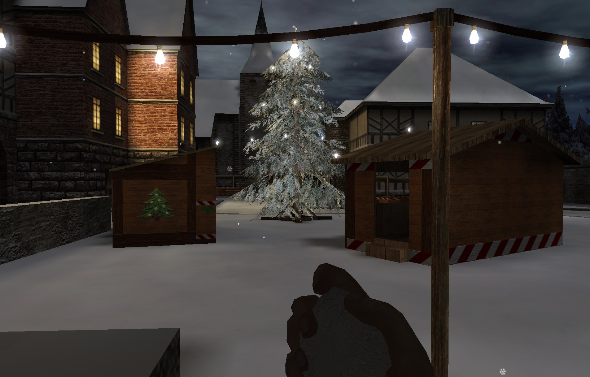
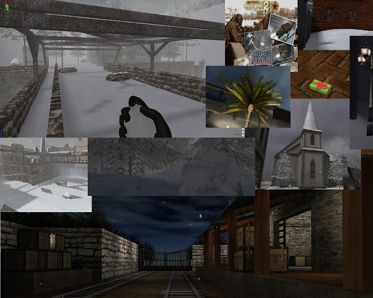
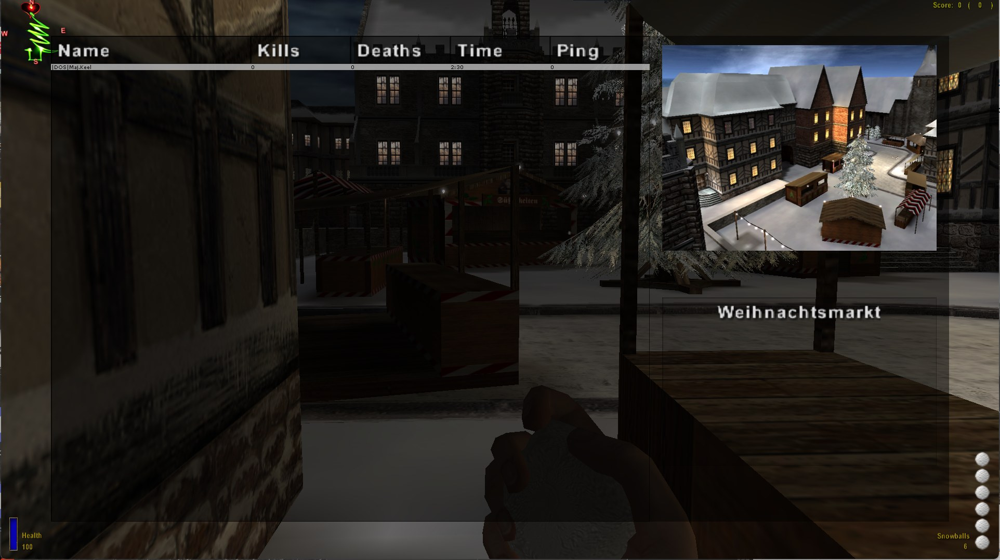

# Snowball Fight

Snowball Fight is the |DOS| fork of JV_Map's Snow Contest for Medal of Honor: Allied Assault. This repository preserves the original Snowball Contest v1.1 release and the Snowball Fight fork packages built on it. The `source/` tree is the Snowball Fight 1.3 pk3 opened up into its game files.

ModDB: https://www.moddb.com/mods/snowball

The original Snowball Contest was developed by **jv_map**. The original readme credits **mohaa_rox** for the snowball model. The original readme and release package are retained here out of interest, posterity, and respect.

The Snowball Fight fork readmes give full creative kudos to JV_Map for developing the underpinning of the snowball contest and the scripting that makes it happen; the added maps and skins were created by many modders and compiled by the |DOS| clan over several years.

## Screenshots

Screenshots from the ModDB page for the |DOS| Snowball Fight mod.

## Downloads

- Latest release: Snowball Fight 1.3 — https://github.com/johnkeel105/snowball-fight/releases/tag/v1.3
- Snowball Fight 1.294 beta1 — https://github.com/johnkeel105/snowball-fight/releases/tag/v1.294-beta1

The pk3 packages are also kept in the repo:

- `releases/v1.3/zzzdossnowballfight1.3.pk3` — Snowball Fight 1.3 package
- `releases/v1.294-beta1/zzzdossnowballfight1.294beta1.pk3` — Snowball Fight 1.294 beta1 package
- `releases/v1.1/user-snowcontest2.pk3` — original Snowball Contest v1.1 package

## Repository contents

- `source/` — Snowball Fight 1.3 opened up from `zzzdossnowballfight1.3.pk3`, preserving its game paths
- `releases/` — packaged pk3 files
- `docs/original-readme-v1.1.txt` — original Snowball Contest v1.1 readme
- `docs/dos-snowballfight-1.294beta1.txt` — Snowball Fight 1.294 beta1 readme
- `docs/dos-snowballfight-1.3.txt` — Snowball Fight 1.3 readme
- `docs/images/` — README screenshots from ModDB

## Install Snowball Fight 1.3

Copy `releases/v1.3/zzzdossnowballfight1.3.pk3` into the MOHAA `main` folder. Remove old Snowball Fight versions from `main` first. Remove the PK3 from `main` to uninstall it.

Snowball Fight 1.3 map list:

- `dm/backyard` — Backyard
- `dm/belowzero1` — Below Zero
- `dm/dmxfire2v2` — Crossfire Courtyard 2v2
- `dm/dv_snow` — Destroyed Village Snow
- `dm/raildepotfinal` — Rail Depot Final (Snow Edition)
- `dm/stalingradsnow` — Stalingrad Snow
- `dm/stalingrad_snow2` — Stalingrad Snow II
- `dm/user_98snowsniperfury` — Snow Sniper Fury
- `dm/weihnachtsmarkt` — Weihnachtsmarkt

See `docs/dos-snowballfight-1.3.txt` for the full Snowball Fight changelist and known issues.

## Install the original release

Copy `releases/v1.1/user-snowcontest2.pk3` into the MOHAA `main` folder. Remove that PK3 from `main` to uninstall it.

See `docs/original-readme-v1.1.txt` for the original installation notes, server settings, and map-author instructions.

## Licensing

The supplied archives do not include a license file. The repository license is therefore unspecified; the original credits and notices are preserved.
